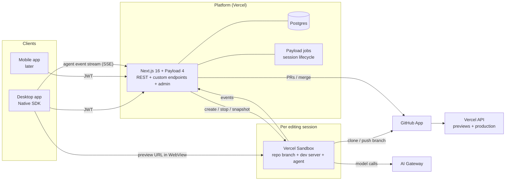
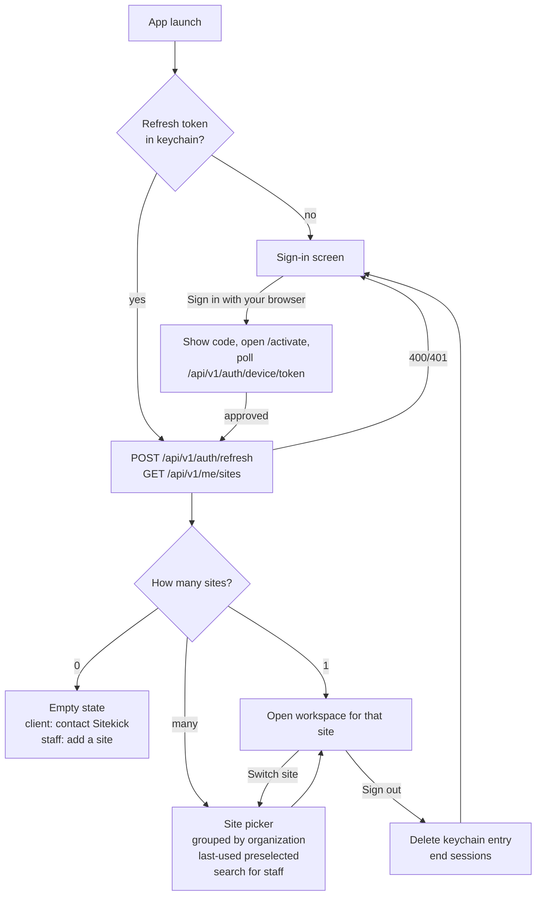

# Sitekick: architecture and initial plan

Status: draft, 2026-10-15. The decisions marked **Decided** came from John.

## What Sitekick is

A platform where Sitekick staff and our clients' marketing teams edit client websites by working with AI agents, in the spirit of Source by Webflow. The desktop app comes first and a mobile app follows later.

## Decisions

| Topic | Decision | Status |
| --- | --- | --- |
| Who logs in | Sitekick staff and client team members. Clients see their own organization's sites, and staff can reach every site. | Decided |
| Where editing runs | Cloud sandboxes: one Vercel Sandbox per editing session, holding the checked-out repo, a dev server and the agent. Clients install nothing. | Decided |
| What a site is (v1) | A GitHub repo plus a Vercel project, built on our Next.js + Payload stack. Changes ship as branches and PRs. | Decided |
| Desktop client | Native SDK (this repo) | Decided |
| Platform backend | Next.js 16 + Payload 4 on Vercel (pinned to yimby-website's version, 4.0.0-beta.3 since October 2026; Payload upgrades land in yimby first, then here), with Payload's own auth for now. We may move to Better Auth or Clerk later if clients need SSO, social login or MFA. | Decided |

## Platform backend: Payload or Clerk?

We already run our site stack on Payload 3 (yimby-website uses 3.90 with `plugin-multi-tenant`, `db-postgres`, `plugin-mcp`, an auth-enabled `Users` collection and admin invites). The question is whether Sitekick's own accounts and data live in Payload too, or whether we put a dedicated identity provider like Clerk in front.

**What Payload gives us for free**

- **One system of record.** Users, organizations, sites, sessions and audit history sit in one Postgres database with one schema, and nothing has to be synced from a third party.
- **An admin back office.** Staff get Payload admin for onboarding clients, adding sites, managing members and inspecting sessions, without building any UI for it.
- **Multi-tenancy we already know.** Organizations map to tenants in `plugin-multi-tenant`, and staff are the cross-tenant super-admins. That is the same pattern as yimby.
- **Auth that already works.** `auth: true` provides login, JWT, refresh, password reset, email verification, API keys for machine callers, and the invite flow we've already built once.
- **Jobs and MCP.** The Payload jobs queue can drive sandbox lifecycle and cleanup. `plugin-mcp` could let agents query the platform for things like site settings.
- **Fit with the team.** It's the stack the team uses every day, and client sites are Payload too. Later, agents could edit a site's CMS content through that site's own Payload MCP, not just its code.

**Where Payload is weaker than Clerk**

- **Not an OAuth identity provider.** Payload has no OAuth2/PKCE authorization server for native apps. Social login, SSO and MFA need plugins or custom strategies.
- **More security surface we own.** Rate limiting, lockout and password policy are ours to configure and test.

**Clerk's costs**

- **Two sources of truth.** Users live in Clerk and the data lives in our database, kept in step by webhooks.
- **Admin integration.** Payload admin would need a custom auth strategy to accept Clerk sessions.
- **Ongoing expense and lock-in.** Pricing is per active user, and client identities live with a vendor.

**Decision (2026-10-15): Payload, using its built-in auth for v1, with the auth boundary kept swappable.** Move to Better Auth or Clerk if clients need SSO, social login or MFA, or if Sitekick becomes self-serve for other agencies.

### Auth guardrails (these keep a later swap cheap)

1. **Clients never call Payload auth routes directly.** They use our own `/api/v1/auth/login`, `/api/v1/auth/refresh`, `/api/v1/auth/logout` and `/api/v1/me`, which wrap Payload. Swapping the identity provider only changes these handlers.
2. **Our `users` collection is the canonical identity.** Every relation references our user ID. An external provider is mapped through an `authProviderId` field, never used as a foreign key.
3. **Tokens are generic to the client:** a short-lived access token plus a refresh token in the OS keychain. The client makes no Payload-specific assumptions.
4. **Revocation and abuse limits from day one:** Payload server-side sessions (logout and device revocation work), `maxLoginAttempts` and `lockTime`, and rate limiting on the login route.
5. **Don't customize password hashing.** Moving hashes into Better Auth or Clerk without forcing resets is probably possible, but verify it at migration time.


- **v1 login (revised for M1):** browser sign-in with a device code (RFC 8628). Native SDK has no secure text field, and its guidance keeps passwords out of app state, so the desktop app never takes a password. It calls `POST /api/v1/auth/device`, opens `/activate` in the system browser, where the person signs in with Payload's cookie session and approves the code, and polls `/api/v1/auth/device/token` for the usual token pair, which goes into the Keychain.
- **Later SSO:** when clients ask for SSO (for example Google Workspace), add a browser-based login. The desktop opens the system browser to the platform's `/desktop/login` page with a PKCE challenge, the user signs in there (password, Google, or anything else Payload supports), and the platform redirects to `sitekick://auth/callback` with a one-time code that the app exchanges for a token. The data model and API don't change, only how the token is issued.
- **If we outgrow Payload auth:** plug an IdP (Clerk, Auth0, or WorkOS) into Payload as a custom auth strategy. Payload stays the system of record.

## System overview



Clients are thin. Everything stateful lives on the platform or in the sandbox, which is what makes a mobile client cheap later.

## Domain model (Payload collections)

| Collection | Key fields | Notes |
| --- | --- | --- |
| `users` | email, name, `kind` (`staff` / `client`), auth | Staff are cross-tenant super-admins |
| `organizations` | name, slug, `kind` (`agency` / `client`) | The tenant |
| `memberships` | user, organization, role (`owner` / `editor` / `viewer`) | A user can belong to several orgs |
| `invites` | email, organization, role, token, expiresAt | Reuses the yimby invite pattern |
| `sites` | organization, name, githubRepo, defaultBranch, vercelProjectId, productionUrl, `publishPolicy` (`direct` / `staff-approval`) | |
| `sessions` | site, user, sandboxId, branch, status, previewUrl, startedAt, lastActiveAt, endedAt | One editing session = one sandbox |
| `messages` | session, role (user / agent / tool), content, createdAt | The agent conversation transcript |
| `changes` | site, session, branch, prUrl, status (`draft` / `in-review` / `published` / `discarded`), previewDeploymentUrl | What gets published |
| `auth-sessions` | user, deviceName, tokenHash, previousTokenHash, expiresAt, lastUsedAt, revokedAt | One signed-in device. Holds the rotating refresh token (hashed). Staff revoke a device by setting `revokedAt`. |
| `audit-log` | actor, action, target, metadata | Written by hooks |

**Access rule:** a user can read a site when they are staff or hold a membership in the site's organization. This is implemented directly from `memberships` (`apps/platform/src/access`), not with `plugin-multi-tenant`. The plugin keeps a tenants array on each user, which would duplicate `memberships`, and the desktop app doesn't need its admin tenant switcher. Publishing needs the `editor` role or higher, plus staff approval when the site's `publishPolicy` says so.

## Sign-in and site selection

This is the flow you asked for: after login, either ask which site or go straight to the only one.



- `GET /api/v1/me/sites` returns accessible sites with their organization and the user's role. Staff see every site, so the picker needs search and grouping from day one.
- The last-used site is stored locally (`Cmd.store`) so the picker can highlight it. It never auto-opens a site unless the user has exactly one.
- Tokens are kept only in the OS keychain (one `session` item), never in the Model. The core reads the item for each call and builds the header immediately.

## Desktop app (this repo)

- **Core (`src/core.ts`):** the screen state machine (`signedOut` → `pickingSite` → `workspace`), the selected site, session status, and the chat transcript view model.
- **Services (`src/services/`):** an API client (`fetch` with JWT and refresh), the SSE stream for agent events, and keychain helpers.
- **Views:**
  - Sign in.
  - Site picker.
  - Workspace, in three parts: a sidebar (site switcher, sessions, changes), a center **WebView** showing the sandbox's preview URL, and a right **agent chat** panel. A top bar shows branch and status and has a **Publish** button.
- **WebView security:** add the preview origin to the WebView's `security.navigation` allowlist per session. The preview is untrusted content and gets no bridge access.

## Editing session lifecycle

1. **Start:** the user opens a site. The platform creates (or resumes) a session, and a Sandbox boots from a per-site **snapshot** with dependencies already installed. It checks out `sitekick/<session-id>` from the default branch, starts `next dev`, and returns the preview URL.
2. **Edit:** the user chats. The platform forwards messages to the agent running in the sandbox (Claude Agent SDK through AI Gateway). The agent edits files, hot reload updates the preview, and events stream back to the client.
3. **Save:** the agent or user commits to the session branch and pushes through the GitHub App. A Vercel preview deployment is created for the branch.
4. **Publish:** a PR opens. Depending on `publishPolicy`, it either merges directly or waits for staff approval. Merging deploys production.
5. **Idle and end:** a Payload job stops idle sandboxes after N minutes. The branch keeps the work, so resuming means a fresh sandbox on the same branch.

## Repo layout (proposed)

Make this repo a monorepo. Each feature then lands in one PR across client and platform.

```
apps/desktop/    Native SDK app (what's at the root today)
apps/platform/   Next.js 16 + Payload 4 (Bun, Vercel)
docs/
```

The Native SDK core can't import npm packages. Shared API types are generated from the Payload schema into `apps/desktop/src/api/` by a script, and the generated files are committed.

## Milestones

| # | Milestone | Done when |
| --- | --- | --- |
| M0 | Platform skeleton | Payload app deployed on Vercel with Postgres. Users, organizations, memberships, invites and sites exist. Staff can sign in to the admin. **Status: done (2026-10-18).** Live at https://sitekick-platform.vercel.app on Neon (Sitekick org, Oregon), with migrations on deploy and the first staff account created. Hardening carried forward: GitHub connection with per-preview Neon branches, an email adapter, and login rate limiting (apps/platform/README.md, "Not done yet"). |
| M1 | Desktop sign-in + site picker | Sign in through `/api/v1/auth/*`, keychain session, `/api/v1/me/sites`, auto-open for one site, picker for several, switch site, sign out. **Status: done (2026-10-18).** Browser device sign-in instead of a password form, Keychain session with refresh-and-retry, picker or auto-open, last site remembered, sign-out with revocation. Tested headless (`dev-script.ndjson`) and in the real app against the local platform. |
| M2 | Site connection | GitHub App installed and Vercel project linked. Staff register a site in the admin and the platform verifies access. **Status: done (2026-10-18).** GitHub App Sitekick Platform installed on sitekickcodes, Vercel token set, and YIMBY Action registered as the first real site with status Connected (app can push, Vercel project deploys the same repo). Client-owned Vercel teams are still to come. |
| M3 | Editing session + preview | Opening a site boots a sandbox from a snapshot and shows the live preview in the WebView. Idle shutdown and resume work. |
| M4 | Agent chat | Chat in the right panel drives an agent in the sandbox. Events stream, edits show in the preview, and changes can be undone. |
| M5 | Publish | Commit to the session branch, PR, Vercel preview, optional staff approval, merge to production. |
| M6 | Production readiness | Audit log, per-org usage limits, notifications, packaging, code signing and notarization, auto-update. |
| Later | Mobile, CMS edits through the site's Payload MCP, click-to-select elements in the preview | |

## Risks and open questions

- **Database for Payload sites inside a sandbox.** `next dev` for a Payload site needs a database. Options are a Postgres branch per session (Neon-style branching), a shared preview database per site, or read-only production. This needs a decision before M3.
- **Native SDK maturity.** It's pre-1.0, we're already working around [vercel-labs/native#713](https://github.com/vercel-labs/native/issues/713), and mobile is experimental. Keeping clients thin limits the blast radius.
- **WebView and native canvas in one window.** Supported by the SDK, but prove it early in M1/M3.
- **Sandbox cost and cold start.** Use per-site snapshots and idle timeouts, and track per-org usage.
- **Client-owned repos.** Some clients may own their GitHub org. The GitHub App install flow has to cover both our org and theirs.
- **Secrets in sandboxes.** Use scoped, per-site preview env vars only, never production secrets.
- **Agent provider and limits.** Choose the model and set budgets per org through AI Gateway.
